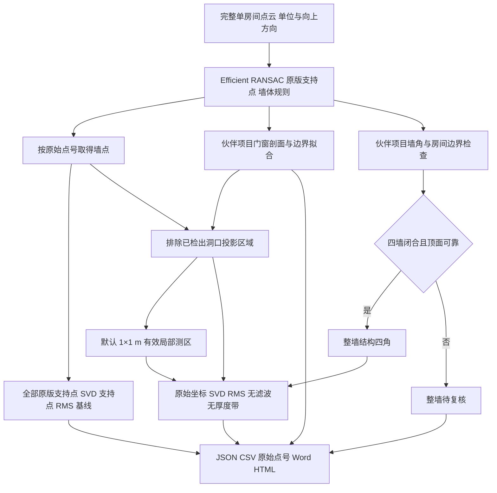

# 房间点云自动测量组合项目

输入一个完整房间的 PCD 或 XYZ CSV，输出房间尺寸、门窗尺寸与位置、墙角、局部测区、各墙 RMS，以及 Word / HTML 测量报告。

**门窗、墙角、局部测区、窗框深度和报告流程以提供的 Task 1 项目为准；分墙使用完整点云的原版 Efficient RANSAC 支持点，粗糙度采用无滤波 SVD RMS。** 所需 Python 源码都在本仓库，不依赖另一个本地项目目录。原版 C++ 检测器按固定版本下载编译，二进制不上传。

## 五接口流程



“取回原始墙点”仅指索引查表，不扩张点集。主粗糙度流程不降采样、不去噪、不平滑、不使用 50 mm 恢复带或 RMS 厚度筛选。门窗面层、窗框深度切片、局部覆盖网格及角点外推检查属于各自几何处理，不改变 `support` 基线。

## 安装与运行

已验证平台为 Windows、Python 3.11、Node.js 和 MinGW g++。需安装 Git、Python 3.10+、Node.js 18+，并让 g++ 在 PATH 中可用。

```powershell
git clone https://github.com/x13230802751/room-inspection-integrated.git
cd room-inspection-integrated
py -3 -m venv .venv
.\.venv\Scripts\python.exe -m pip install -r requirements.txt
.\.venv\Scripts\python.exe native_backend/scripts/fetch_native.py
.\.venv\Scripts\python.exe native_backend/native/build.py --source-root native_backend/native/sources
.\.venv\Scripts\python.exe inspect_room.py 'D:/data/room.pcd' --unit m --up 0 0 1 --out results/my_room
```

也可双击 `run.cmd` 使用本地网页选择点云。默认 profile 即组合主方法；用 `--patch-size WIDTH HEIGHT` 调整局部测区。输入支持 `archive.zip::member.pcd`。每次指定新输出目录。缺少原版二进制会报错，不会回退到旧分墙。

## 输入输出

| 输入 | 输出 |
|---|---|
| 单房间完整点云；m/mm；向上方向；无需手工四点 | 墙候选及原始点号、房间长宽高、门窗位置宽高和深度候选、整墙角点、局部测区、RMS、复核标记 |
| 可选 profile / 局部大小 | 五接口可替换，参数与实际函数指纹记录在 summary.json |

- `support`：全部原版墙支持点 RMS，未做门窗排除或四角裁剪；用于和独立粗糙度项目核对。
- `whole`：按伙伴项目排除检出洞口后，整墙结构四角内的支持点 RMS。
- `patch`：按伙伴项目选择局部区域，在排除检出洞口后的原始支持点上独立拟合的 RMS。

三个测量域不同。RMS 为 mm，坐标为 m，点号为原始记录的零起始序号。JSON、CSV、Word 和 HTML 均给出结果。wall_points.npz 与各测区 residuals.npz 用于逐点复核；native_supports.txt 保存原版检测支持点。

## 文档与验证

- [组合方案与任务说明 Word](docs/组合方案与任务说明.docx)
- [Task 1 完整实验总报告](docs/Task1_Evaluation.docx)
- [说明 Markdown](docs/project_guide.md)
- [接口说明](INTERFACE_SPEC.md)
- [官方 GT 对照](docs/gt_comparison.md)
- [实测审计](validation/integration_verification.json)
- [源码来源](docs/source_map.json)
- [原版算法与许可](native_backend/PROVENANCE.md)

```powershell
python tests/check_native_support.py
python tests/check_extensions.py
python tests/check_pipeline.py
python tests/check_reporting.py results/my_room
```

检查覆盖无 50 mm RMS 厚度筛选、原始点号、导入隔离、旋转坐标、毫米单位、非有限行、双门、窗和无顶面。实测审计将 M04、M26 八面墙的支持集和 RMS 与独立框架核对。运行成功不等于工程精度合格；门窗身份、测区对应和实际尺寸仍需独立真值验证。

完整实验总报告基于重新运行的 M04、M26，汇总尺寸、门窗与三种测区的 RMS。原始点云和逐点运行产物保存在本地。
